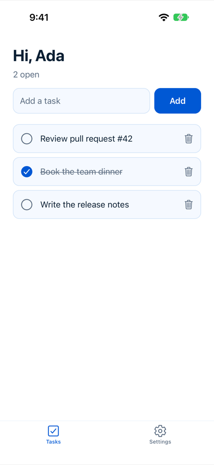
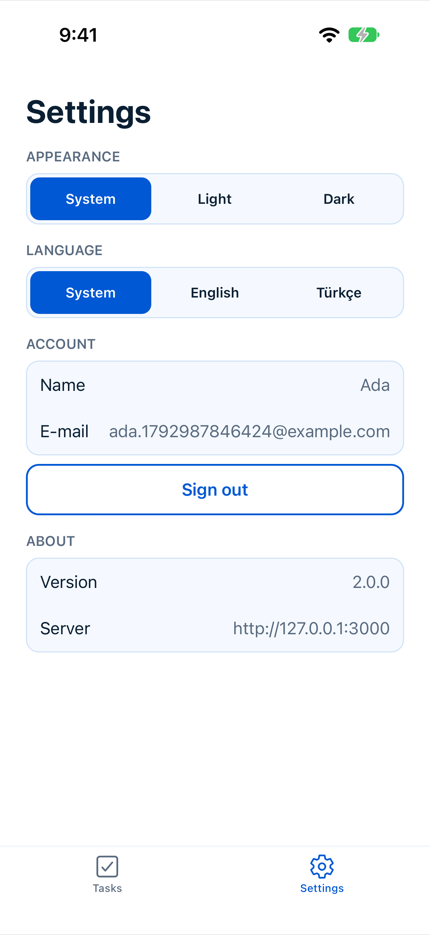
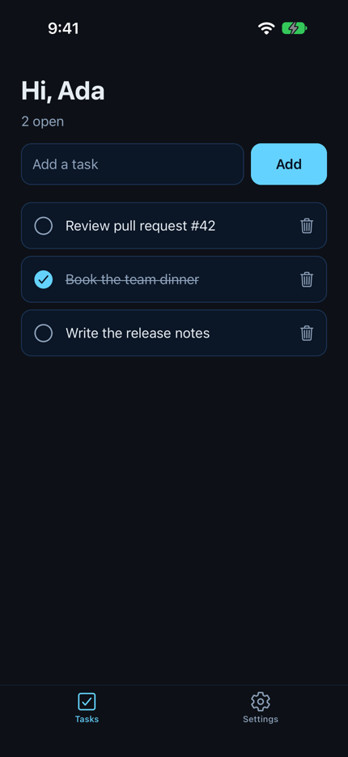
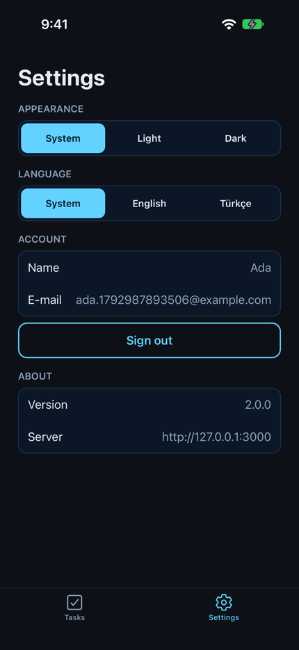

<!-- i18n-source: README.md@e710ff19fabecf77a6d22e7ad05eba52ba44f827 status=reviewed -->
<!-- brand:start -->

<p align="center"><picture><source media="(prefers-color-scheme: dark)" srcset="https://raw.githubusercontent.com/muhittincamdali/ReactNativeStarter/main/.github/brand/banner-dark.svg"><source media="(prefers-color-scheme: light)" srcset="https://raw.githubusercontent.com/muhittincamdali/ReactNativeStarter/main/.github/brand/banner-light.svg"></picture></p>

<!-- lang-selector:start -->
<p align="center"><a href="README.md">English</a> · <a href="README.tr.md">Türkçe</a> · <a href="README.zh-CN.md">简体中文</a> · <a href="README.ja.md">日本語</a> · <a href="README.ko.md">한국어</a> · <a href="README.es.md">Español</a> · <a href="README.de.md">Deutsch</a> · <a href="README.fr.md">Français</a> · <a href="README.pt-BR.md">Português (Brasil)</a> · <a href="README.ru.md">Русский</a></p>
<!-- lang-selector:end -->

<p align="center">
<a href="https://github.com/muhittincamdali/ReactNativeStarter/actions/workflows/ci.yml"></a>
<a href="https://github.com/muhittincamdali/ReactNativeStarter/releases"><picture><source media="(prefers-color-scheme: dark)" srcset="https://raw.githubusercontent.com/muhittincamdali/ReactNativeStarter/main/.github/brand/badge-version-dark.svg"><source media="(prefers-color-scheme: light)" srcset="https://raw.githubusercontent.com/muhittincamdali/ReactNativeStarter/main/.github/brand/badge-version-light.svg"></picture></a>
<a href="https://github.com/muhittincamdali/ReactNativeStarter/blob/main/package.json"><picture><source media="(prefers-color-scheme: dark)" srcset="https://raw.githubusercontent.com/muhittincamdali/ReactNativeStarter/main/.github/brand/badge-language-dark.svg"><source media="(prefers-color-scheme: light)" srcset="https://raw.githubusercontent.com/muhittincamdali/ReactNativeStarter/main/.github/brand/badge-language-light.svg"></picture></a>
<a href="https://github.com/muhittincamdali/ReactNativeStarter/blob/main/LICENSE"><picture><source media="(prefers-color-scheme: dark)" srcset="https://raw.githubusercontent.com/muhittincamdali/ReactNativeStarter/main/.github/brand/badge-license-dark.svg"><source media="(prefers-color-scheme: light)" srcset="https://raw.githubusercontent.com/muhittincamdali/ReactNativeStarter/main/.github/brand/badge-license-light.svg"></picture></a>
</p>

<p align="center">
<a href="#クイックスタート"><picture><source media="(prefers-color-scheme: dark)" srcset="https://raw.githubusercontent.com/muhittincamdali/ReactNativeStarter/main/.github/brand/button-start-ja-dark.svg"><source media="(prefers-color-scheme: light)" srcset="https://raw.githubusercontent.com/muhittincamdali/ReactNativeStarter/main/.github/brand/button-start-ja-light.svg"></picture></a>
<a href="https://muhittincamdali.github.io/ReactNativeStarter/"><picture><source media="(prefers-color-scheme: dark)" srcset="https://raw.githubusercontent.com/muhittincamdali/ReactNativeStarter/main/.github/brand/button-docs-ja-dark.svg"><source media="(prefers-color-scheme: light)" srcset="https://raw.githubusercontent.com/muhittincamdali/ReactNativeStarter/main/.github/brand/button-docs-ja-light.svg"></picture></a>
<a href="https://github.com/muhittincamdali/ReactNativeStarter/tree/main/Examples"><picture><source media="(prefers-color-scheme: dark)" srcset="https://raw.githubusercontent.com/muhittincamdali/ReactNativeStarter/main/.github/brand/button-examples-ja-dark.svg"><source media="(prefers-color-scheme: light)" srcset="https://raw.githubusercontent.com/muhittincamdali/ReactNativeStarter/main/.github/brand/button-examples-ja-light.svg"></picture></a>
</p>

> このドキュメントは英語版 README の翻訳です。内容が異なる場合は英語版が最新です。

<!-- brand:end -->

そのまま出発点にできる Expo アプリです。iOS、Android、Web で動作し、バックエンドを Expo Router の API routes として内蔵しているため、`npm ci` と `npx expo start` を実行するだけで、ほかのサーバーを用意しなくてもサインアップ、サインイン、タスクリストがエンドツーエンドで動きます。空の画面が並ぶだけのフォルダーではなく、アカウント、データ、テーマ、翻訳、テストを備えた動くアプリを初日から使いたい開発者に向けた、読みやすく変更しやすい TypeScript のスターターです。

## 主な特長

- **同じプロジェクトにバックエンドを同梱** — `src/app/api` の API routes が、サインアップ、サインイン、サインアウト、そしてタスクの作成、一覧、更新、削除を処理します。開発サーバーはこれらをアプリと一緒に実行し、`npm run build` は Node.js、EAS Hosting、Vercel、Netlify、Cloudflare 向けにエクスポートします。
- **両側で共通の schema** — リクエストとレスポンスの形は `src/shared` の zod schema です。API はすべての本文をこれで検証し、アプリはすべての応答をこれでパースします。
- **丁寧に作られたアカウント** — PBKDF2 によるパスワードハッシュ（反復 600,000 回）、SHA-256 ハッシュのみを保存するランダムなセッショントークン、iOS Keychain と Android Keystore に保存されるトークン、攻撃されたアカウントの持ち主を締め出さずに速度を落とす、クライアントアドレスごとのサインインとサインアップの制限、そして誤ったアドレスと誤ったパスワードに対する同じ応答。
- **設計段階で上限を設定** — ストリームとして読み込む 16 KiB のリクエスト本文、1 MiB の応答、アカウントあたり 500 件のタスク、最大 100 件のページ、厳密な整数のクエリパラメーター、上限付きのセッションテーブルとレートリミッターのテーブル。どのリクエストも、サーバーにより多くのメモリを保持させたり、より長くループさせたりすることはできません。
- **実際の利用者のために** — ライトテーマとダークテーマ、型付きキーによる英語とトルコ語、オフラインに強いサインイン、楽観的（optimistic）なタスク更新、アクセシビリティのロールとラベル、48 ポイントのタッチターゲット。
- **schema から画面までテスト済み** — 本物の画面を本物の API ハンドラーに対して同じプロセス内で描画するテストを含む 281 個の Jest テストに加え、ビルド済みアプリを iOS シミュレーターで実行する Maestro フローがあります。

## クイックスタート

**1. コードを取得する**

```sh
git clone https://github.com/muhittincamdali/ReactNativeStarter.git my-app
cd my-app
npm ci
```

[Node.js](https://nodejs.org/) 22.14 以降が必要です。ブラウザーで試すだけなら、ほかに何もインストールする必要はありません。

**2. 起動する**

```sh
npx expo start
```

アプリとその API が一緒に起動します。**w** を押すとブラウザーで、**i** を押すと iOS シミュレーターで、**a** を押すと Android エミュレーターで開きます。同じネットワーク上のスマートフォンの [Expo Go](https://expo.dev/go) アプリで QR コードを読み取ることもできます。

**3. 使ってみる**

**New here? Create an account** をタップし、名前、メールアドレス、8 文字以上のパスワードを入力すると、タスクリストが表示されます。タスクを追加し、丸をタップして完了にしたら、**Settings** に切り替えてダークテーマやトルコ語を試してみてください。`src/features/tasks/TasksScreen.tsx` を編集すると、保存した時点で画面が更新されます。

## インストール

このリポジトリがそのままアプリです。上記のとおりクローンし、`rm -rf .git && git init` で自分の履歴を新しく始めて、自分のアプリに仕立ててください。

1. `app.json` の `name`、`slug`、`scheme`、`ios.bundleIdentifier`、`android.package` を変更します。
2. `assets/icon.svg` を差し替え、`node scripts/render-icons.mjs` を実行してすべてのアイコンを生成します。
3. 色は `src/theme/index.ts` で、文言は `src/lib/i18n/` で変更します。

Expo Go ではなくネイティブの開発ビルドで実行するには、`npm run ios`（Xcode のある macOS）または `npm run android`（Android Studio）を使います。

## 使い方

以下のサンプルは [`Examples/`](Examples) からコピーしたものです。このディレクトリは `npm run typecheck` でコンパイルされ、`npm test` で実行されます。

### API route を追加する

`src/app/api` にある `<name>+api.ts` という名前のファイルが `/api/<name>` に応答します。`handle()` は投げられた `HttpError` を対応する応答に変換し、`authenticate()` はサインイン済みのリクエストだけを通します（[`Examples/task-stats/stats+api.ts`](Examples/task-stats/stats+api.ts)）。

```ts
export function GET(request: Request): Promise<Response> {
  return handle(async () => {
    const { accounts, tasks } = getServerApp();
    const user = await accounts.authenticate(request);
    let total = 0;
    let done = 0;
    let cursor: string | undefined;
    for (let page = 0; page < MAX_PAGES; page += 1) {
      const result = tasks.list(user.id, { limit: MAX_PAGE_SIZE, cursor });
      if (!result) break;
      total += result.items.length;
      done += result.items.filter((task) => task.done).length;
      if (!result.nextCursor) break;
      cursor = result.nextCursor;
    }
    return json({ total, done, open: total - done });
  });
}
```

### アプリから呼び出す

API クライアントはセッショントークン、時間制限、サイズ制限を付け加え、応答を zod schema でパースします。一致しない場合は、画面に届く前に `ApiError` として失敗します（[`Examples/task-stats/schema.ts`](Examples/task-stats/schema.ts)）。

```ts
export const taskStatsSchema = z.object({
  total: z.number().int().nonnegative(),
  done: z.number().int().nonnegative(),
  open: z.number().int().nonnegative(),
});

export function fetchTaskStats(client: ApiClient, signal?: AbortSignal): Promise<TaskStats> {
  return client.request('/api/stats', { schema: taskStatsSchema, ...(signal ? { signal } : {}) });
}
```

### 画面に表示する

データの読み込みは React Query が行い、`errorMessageKey()` はあらゆる失敗を翻訳済みの文に変換します（[`Examples/task-stats/TaskStatsCard.tsx`](Examples/task-stats/TaskStatsCard.tsx)）。

```tsx
const stats = useQuery({ queryKey: ['task-stats'], queryFn: ({ signal }) => fetchStats(signal) });

return (
  <View style={[styles.card, { backgroundColor: colors.surface, borderColor: colors.border }]}>
    {stats.isPending ? (
      <ActivityIndicator color={colors.accent} />
    ) : stats.isError ? (
      <Text style={{ color: colors.danger }}>{t(errorMessageKey(stats.error))}</Text>
    ) : (
      <Text accessibilityRole="summary" style={[styles.text, { color: colors.text }]}>
        {`${stats.data.done} / ${stats.data.total}`}
      </Text>
    )}
  </View>
);
```

### タスクをデータベースに保存する

タスクは `TaskRepository` インターフェースを通して扱われます。SQLite 版は Node.js 組み込みの `node:sqlite` を使い、インメモリ版と同じコントラクトテストに合格します（[`Examples/sqlite-repository`](Examples/sqlite-repository)）。`src/server/app.ts` の `createServerApp()` の中で差し替えてください。

```ts
tasks: new SqliteTaskRepository('data/tasks.db', { maxPerUser: MAX_TASKS_PER_USER }),
```

## デモ

| サインイン                                                 | タスク                                                 | 設定                                              |
| ---------------------------------------------------------- | ------------------------------------------------------ | ------------------------------------------------- |
|  |  |  |
|   |   |   |

スクリーンショットは、iOS 27 を搭載した iPhone 17 Pro シミュレーター上の Release ビルドから、`npm run build && npm run serve` で起動した本番サーバーに接続して、[`scripts/capture-screenshots.sh`](scripts/capture-screenshots.sh) で撮影したものです。このスクリプトは、サインアップし、3 つのタスクを追加して 1 つを完了する [Maestro フロー](.maestro/sign-up-and-tasks.yaml)を実行します。

## ドキュメント

API リファレンスと解説記事：

- [API リファレンス](https://muhittincamdali.github.io/ReactNativeStarter/) — 共有の schema と上限、API クライアント、セッション、翻訳、サーバーモジュール。ソースコードのコメントから TypeDoc で生成されます。
- [CHANGELOG.md](CHANGELOG.md) — 各バージョンの変更内容。

## ガイド

- [はじめに](https://muhittincamdali.github.io/ReactNativeStarter/documents/Getting_started.html) — あらゆる環境での実行、フォルダー構成、スクリプト、アプリ名の変更。
- [機能の追加](https://muhittincamdali.github.io/ReactNativeStarter/documents/Adding_a_feature.html) — schema、API route、クライアントからの呼び出し、画面、そしてそれらのテスト。
- [デプロイ](https://muhittincamdali.github.io/ReactNativeStarter/documents/Deploying.html) — API の公開、データの保持、アプリの接続先の設定、EAS でのビルド。
- [セキュリティ](https://muhittincamdali.github.io/ReactNativeStarter/documents/Security.html) — このスターターが守るものと、あなたに任せているもの。

同じガイドは Markdown 形式で [`Documentation/`](Documentation) にもあります。

## 動作要件

| ツールチェーン | 最小バージョン                                                      |
| -------------- | ------------------------------------------------------------------- |
| Node.js        | 22.14                                                               |
| Expo SDK       | 58（React Native 0.88、React 19.3）                                 |
| iOS            | 16.4（Expo SDK 58 のデプロイメントターゲット。iOS 27 でテスト済み） |
| Android        | 7.0（API レベル 24）、React Native 0.88 の最小要件                  |

CI は Node.js 22 と 24 で lint、型チェック、テスト、Web ビルドを実行します。ネイティブアプリのビルドと Maestro フローの実行は、Xcode 27.1 を使ってローカルで行っています。

## アーキテクチャ

- **ルートはファイルです。** `src/app` に画面と API routes を置きます（Expo Router）。ルートの layout は、保存されたセッションを読み込む間スプラッシュスクリーンを表示し続け、その後 `Stack.Protected` によって `(app)` または `(auth)` グループを表示します。そのため、deep link でサインインが必要な画面を未サインインのまま開くことはできません。
- **API は素朴な関数です。** 各 `+api.ts` ファイルは `src/server` を呼び出す数行だけです。`http.ts`（上限付きの本文読み込み、JSON 応答、エラーの対応付け）、`accounts.ts`、`passwords.ts`、`sessions.ts`、`rate-limit.ts`、`tasks.ts` があります。`createServerApp()` がこれらを組み立て、テストはテストごとに新しいものを作ります。
- **ストレージはインターフェースの向こうにあります。** `TaskRepository` により、ルートはタスクの保存先に依存しません。既定はインメモリ版で、SQLite の例ではデータベースを使う方法を示しています。
- **アプリの状態は小さく保たれています。** サーバーのデータは React Query に置かれます。セッション（トークンとアカウント）と設定（外観、言語）は 2 つの zustand store です。セッションは `expo-secure-store` に、設定は AsyncStorage に保存され、どちらも読み戻す際に検証されます。
- **エラーの型は 1 つです。** API は `{ error: { code, message, fields } }` を返します。クライアントはあらゆる失敗を種別（`network`、`timeout`、`http` など）付きの `ApiError` に変換し、画面はそれを翻訳済みの文に対応付けます。フィールドのエラーは翻訳キーなので、API のチェック結果は正しいフィールドの下に正しい言語で表示されます。
- **何もログに出力しません。** ESLint の `no-console` ルールは、アプリと API では error です。

チェックをローカルで実行するには次のようにします。

```sh
npm run lint && npm run typecheck && npm test && npm run build
npm run ios          # development build on a simulator, then in another terminal:
npm run e2e:ios      # Maestro flows (sign-up, tasks, settings, form validation)
```

## 本番環境の前に

API はアカウント、セッション、タスク、レート制限のカウントを 1 つのプロセスのメモリに保持し、その規模はデモ向け（アカウント 1,000 件、タスク 100,000 件）です。再起動すると空になり、複数のサーバーインスタンス間では共有されません。実際のユーザーを迎える前に、ストアをデータベースへ、レート制限のカウントをすべてのインスタンスが共有するストアへ移し、プロキシからクライアントアドレスを渡し、アカウント削除とパスワードリセットを追加してください。各手順は[セキュリティガイド](Documentation/Security.md#demo-server-or-production)にあります。

## ロードマップ

- アカウントの削除とパスワードのリセット。App Store Review と実際の利用者に必要なものです。
- SQLite のタスクリポジトリと並ぶ、永続的なアカウントとセッション。
- CI でのエミュレーター上の Android Maestro 実行。

## コントリビューション

コントリビューションを歓迎します。pull request を作成する前に[コントリビューションガイド](CONTRIBUTING.md)と[行動規範](https://github.com/muhittincamdali/.github/blob/main/CODE_OF_CONDUCT.md)をお読みください。セキュリティ上の問題は[セキュリティポリシー](SECURITY.md)に従って非公開で報告してください。

## ライセンス

MIT ライセンスで公開しています。詳細は [LICENSE](LICENSE) を参照してください。
